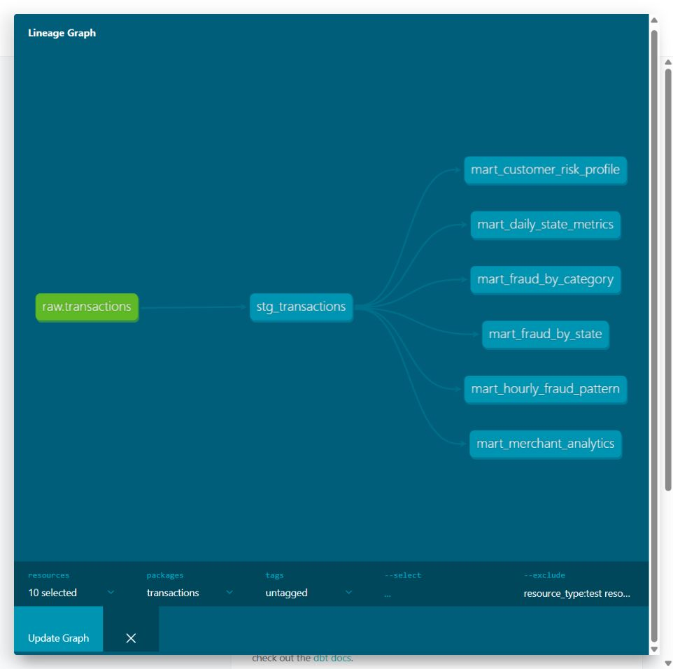

# Домашка 4

Калабай Михаил Иванович

TLDR
За основую брал код из второй дз с кафкой (которая про ClickHouse). Добавил dbt, очистку данных и 6 витрин. Ну и тесты, макросы, документацию и т. д.

## Как запускать это

Как и в прошлых дз Docker Desktop с WSL 2 и линукс контейнерами. Тут ничего нового. Порты 8126 для Клики и 8086 для документации

Как и в прошлые разы надо `train.csv` в data положить

Затем в терминале из папки проекта:

```bash
docker compose --profile tools build
docker compose up -d
docker compose ps -a
```

Потом:

```bash
docker compose run --rm tools python send.py
docker compose run --rm dbt deps
docker compose run --rm dbt build
```

Загрузится весь train, `dbt build` создаст витрины и прогонит тесты, данные в `transactions_db.transactions`, витрины в `analytics`

## Результаты

Сначала `stg_transactions` приводит типы, убирает пробелы, делает ключ клиента, дату, час и группу суммы. Дальше уже витрины

| Витрина | Что считает | Строк |
| --- | --- | --- |
| `mart_daily_state_metrics` | По дню и штату статистики: количество, сумма, средний чек, P95 и доля крупных покупок | 21386 |
| `mart_fraud_by_category` | Количество фродов, их доля и суммы по категориям | 14 |
| `mart_fraud_by_state` | То же по штатам, ещё уникальные клиенты и мерчанты | 51 |
| `mart_customer_risk_profile` | Покупки клиента, средний чек, первая и последняя покупка, уровень риска | 965 |
| `mart_hourly_fraud_pattern` | Фрод по часам и дням недели | 168 |
| `mart_merchant_analytics` | Оборот мерчанта, фрод и флаг подозрительности | 693 |

Пример посмотреть ответ:

```bash
docker compose exec clickhouse clickhouse-client --user student --password local_password --query "SELECT * FROM analytics.mart_fraud_by_category ORDER BY fraud_rate DESC"
```

Доля фрода в процентах. Крупная покупка от 1000, средняя от 100. Риск HIGH от 5% фрода, MEDIUM от 1%, иначе LOW. Подозрительность от 5%. Пороги задал сам. Меняются в `dbt/dbt_project.yml`, логика в двух макросах

## Проверка

```bash
docker compose run --rm dbt test
docker compose run --rm --entrypoint sqlfluff dbt lint models tests
```

Прошли 83 проверки данных и 7 unit tests, ошибок и пропусков нет. [Лог тестов](docs/test.log)

Тесты проверяют пропуски, ключи, допустимые значения и расчёты витрин. Unit tests проверяют очистку и расчёты на маленьких примерах

Пакеты: `dbt_utils`, `dbt_date`, `dbt_expectations`. Версии `dbt-core` 1.12.6 и `dbt-clickhouse` 1.10.3

Есть `Makefile`, настройки sqlfluff и pre-commit. Установить хук:

```bash
python -m pip install pre-commit==4.7.0
python -m pre_commit install
python -m pre_commit run --all-files
```

## Документация

```bash
docker compose run --rm dbt docs generate
docker compose --profile docs up -d docs
```

Документация тут: http://localhost:8086


